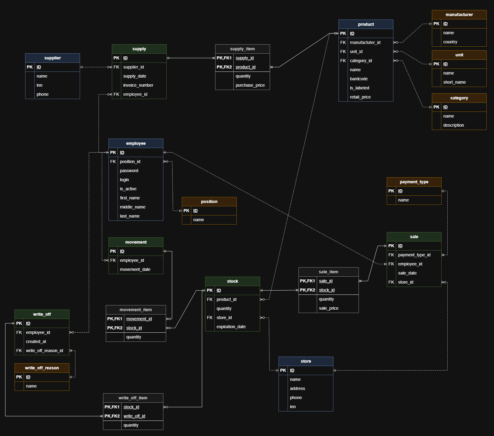

# База данных «Пекарня-магазин»

Учебный проект по дисциплине **«Проектирование баз данных»** (РТУ МИРЭА, ИИТ, кафедра цифровой трансформации, группа ИНБО-20-24).
Полный цикл проектирования БД для розничной пекарни-магазина: от описания предметной области до работающей схемы в **PostgreSQL** с ограничениями целостности и тестовыми данными.



## Что внутри

База учитывает полный цикл движения товара: **поставка → складская партия (со сроком годности) → продажа / перемещение в зал / списание**.

| Группа | Таблицы |
|---|---|
| Справочники | `category`, `unit`, `position`, `payment_type`, `write_off_reason`, `manufacturer` |
| Основные объекты | `supplier`, `store`, `employee`, `product` |
| Документы и регистры | `supply`, `stock`, `sale`, `movement`, `write_off` |
| Позиции документов | `supply_item`, `sale_item`, `movement_item`, `write_off_item` |

Всего **19 таблиц**, составной тип `fio_type` и домен `fio_valid` для ФИО сотрудника.

Что реализовано на уровне СУБД:
- суррогатные ключи `GENERATED BY DEFAULT AS IDENTITY` (стандарт SQL:2003 вместо `SERIAL`);
- `CHECK`-ограничения: ИНН (10/12 цифр), штрих-код (8/13 цифр), телефон, длины названий, цены > 0, количества, длина логина и пароля и др. (23 ограничения, список — в [docs/07](docs/07_postgresql_implementation.md));
- внешние ключи с явными действиями: `ON DELETE RESTRICT` для справочников, `ON DELETE CASCADE` для позиций документов;
- `DEFAULT CURRENT_TIMESTAMP` для дат документов, `DEFAULT true` для `is_active`;
- порядок создания таблиц по уровням зависимости (топологическая сортировка).

## Быстрый старт

Требуется PostgreSQL 14+ (проверено на 16).

```bash
createdb bakery_store
psql -d bakery_store -f sql/install.sql      # схема + тестовые данные
psql -d bakery_store -f sql/03_sample_queries.sql
```

Скрипт можно запускать повторно — он сам удаляет старые таблицы (`DROP ... IF EXISTS`).
Можно также открыть файлы в DBeaver / pgAdmin и выполнить по порядку.

## Структура репозитория

```
├── sql/
│   ├── install.sql            # запускает 01 и 02 одной командой
│   ├── 01_schema.sql          # типы, таблицы, ограничения, внешние ключи
│   ├── 02_seed.sql            # тестовые данные (по 10 строк в таблице)
│   └── 03_sample_queries.sql  # проверочные и примеры аналитических запросов
├── docs/                      # отчёты в Markdown (с рисунками)
├── reports/                   # исходные отчёты (.docx / .pdf)
└── .github/workflows/ci.yml   # автопроверка: SQL разворачивается на PostgreSQL 16
```

## Этапы проекта (документация)

| № | Этап | Документ |
|---|---|---|
| 1–2 | Описание предметной области, требования, сущности, атрибуты, связи, ограничения и бизнес-правила | [docs/01-02_domain_and_entities.md](docs/01-02_domain_and_entities.md) |
| 3 | Инфологическое проектирование (концептуальная ER-модель) | [docs/03_conceptual_model.md](docs/03_conceptual_model.md) |
| 4 | Логическая модель, нотация Мартина | [docs/04_logical_model.md](docs/04_logical_model.md) |
| 5 | Реляционная алгебра (вариант 1, предметная область «Зоомагазин») | [docs/05_relational_algebra.md](docs/05_relational_algebra.md) |
| 6 | Физическое проектирование (ChartDB, доработка SQL) | [docs/06_physical_design.md](docs/06_physical_design.md) |
| 7 | Реализация в PostgreSQL, декларативные ограничения целостности | [docs/07_postgresql_implementation.md](docs/07_postgresql_implementation.md) |

## Дальнейшее развитие

Сложные бизнес-правила из практики 2 (контроль остатков, блокировка просрочки и неактивных сотрудников, автообновление остатков и FIFO при продаже, защита закрытых периодов) требуют триггеров и пока в схеме не реализованы.

## Примечания

- Пароли сотрудников в тестовых данных хранятся открытым текстом — это учебные данные. В реальной системе нужно хранить хэши (например, `pgcrypto`).
- Все имена, ИНН, телефоны и адреса в `02_seed.sql` — вымышленные тестовые данные.

## Автор

Морозов П.Р., ИНБО-20-24, РТУ МИРЭА. Лицензия: [MIT](LICENSE).
