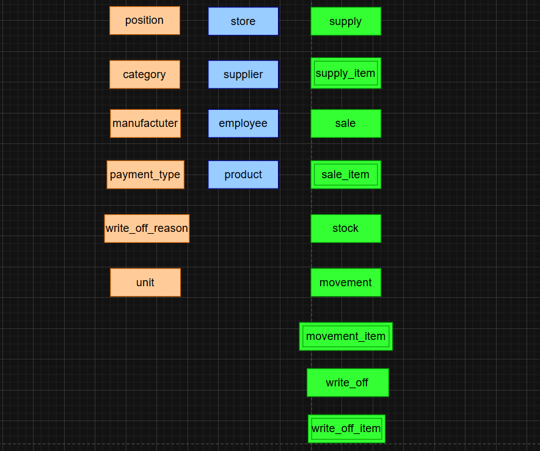
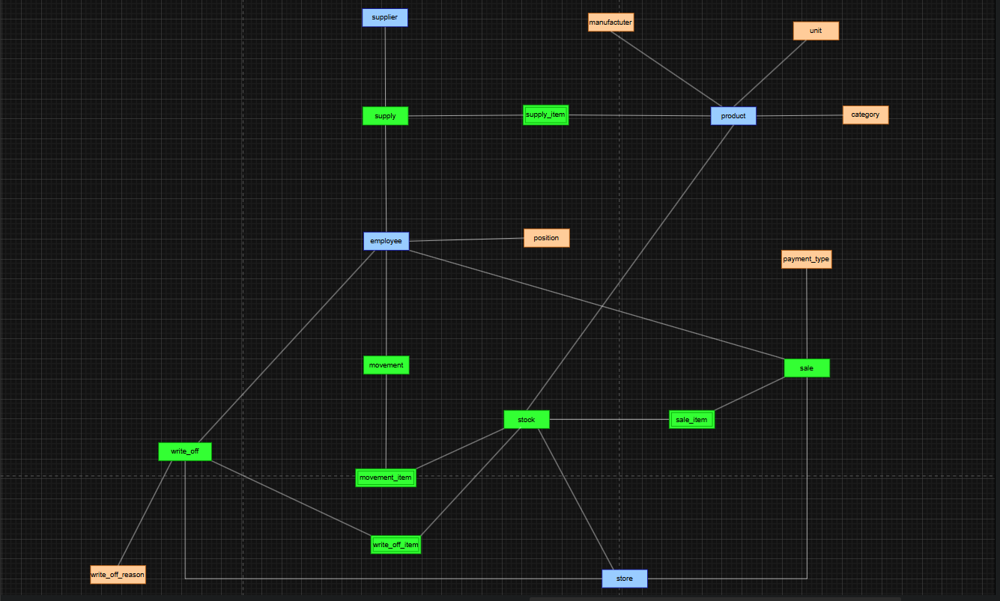
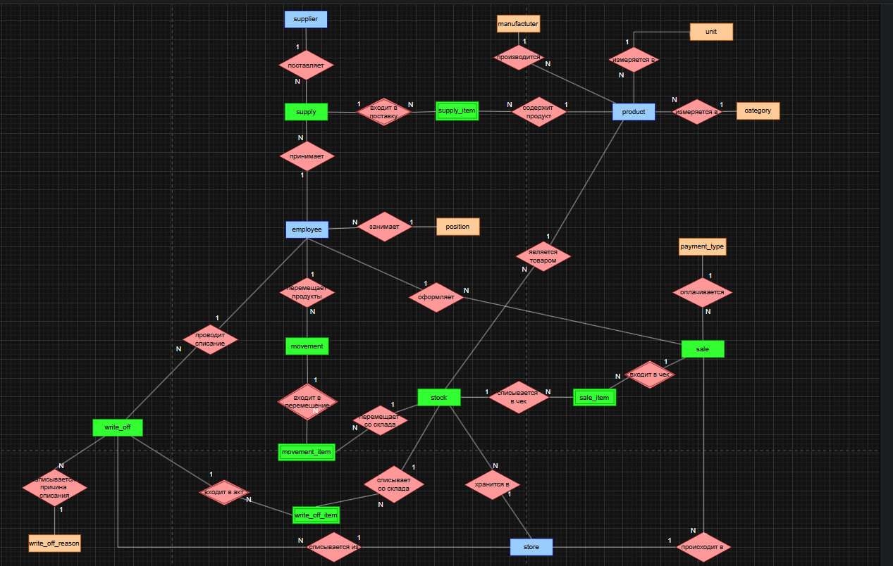
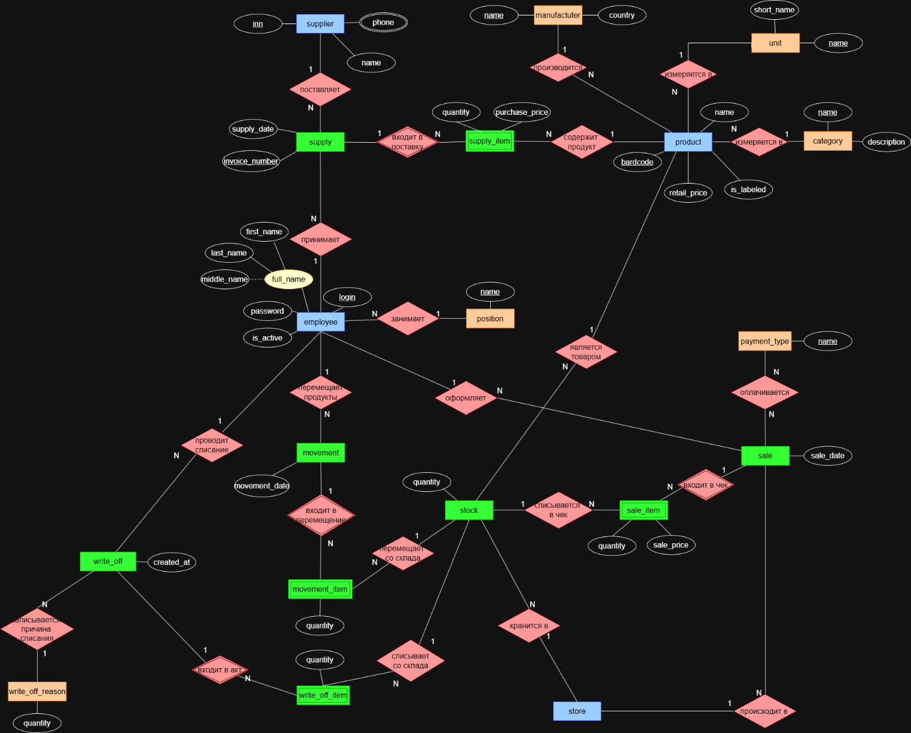

# ПРАКТИЧЕСКАЯ РАБОТА №3. ИНФОЛОГИЧЕСКОЕ ПРОЕКТИРОВАНИЕ БАЗЫ ДАННЫХ (ПОСТРОЕНИЕ КОНЦЕПТУАЛЬНОЙ МОДЕЛИ ДАННЫХ)

## Задание 1: визуализация сущностей

**Рисунок 1 – визуализация сущностей**

## Задание 2: построение связей (создание каркаса диаграммы)

Рисунок 2 – распределение сущностей по схеме

Рисунок 3 – добавление ромбов связей

## Задание 3: добавление и классификация атрибутов

Рисунок 4 – Полная ER-диаграмма
