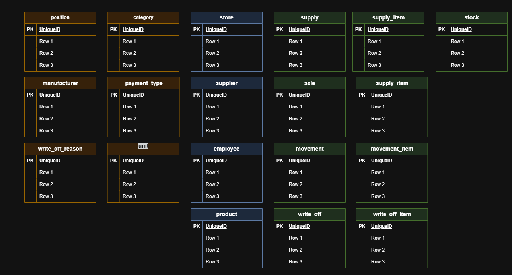
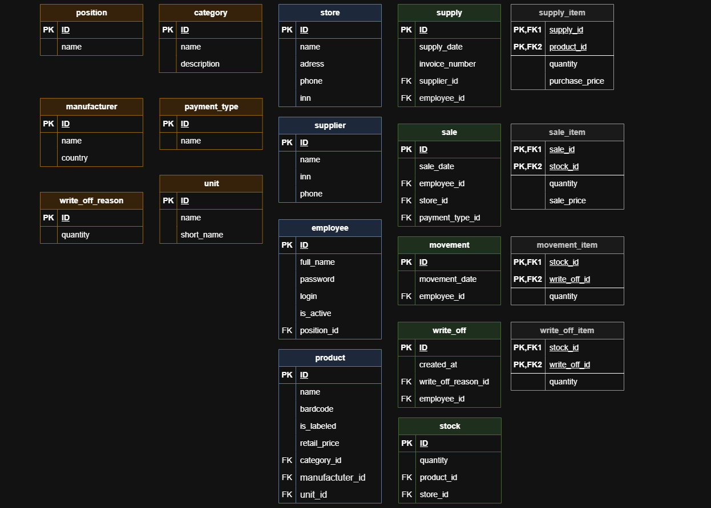
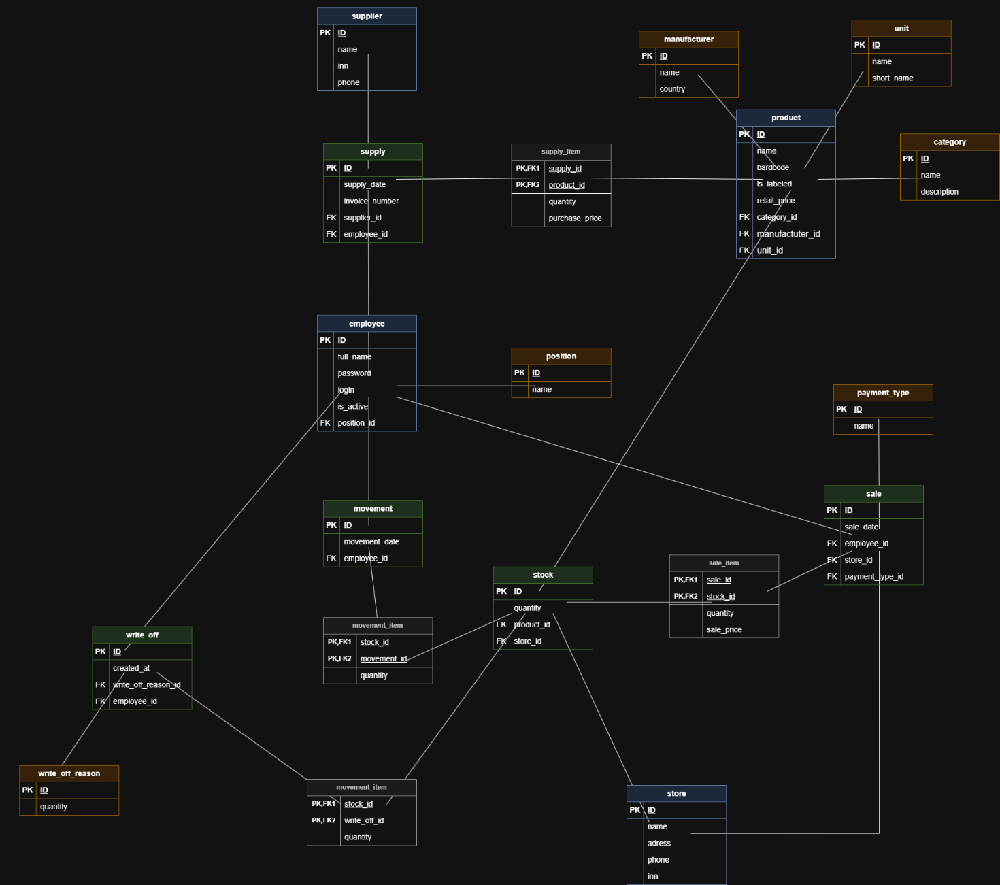
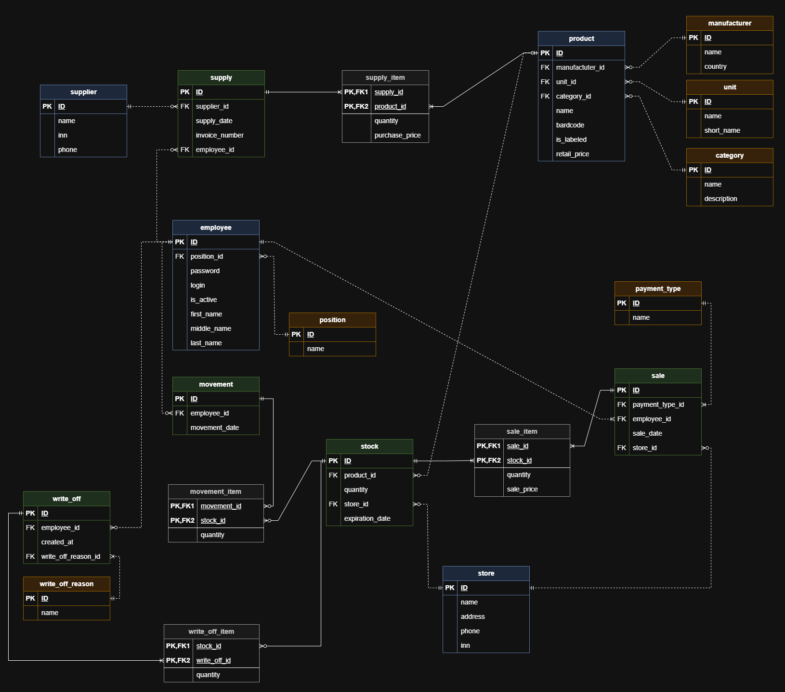

# Практическая работа № 4. Логическое проектирование базы данных (переход к реляционной модели в нотации Мартина)

## Задание 1: Нормализация атрибутов и связей (Подготовка данных)

**Рисунок 1 – создание основных таблиц**

## Задание 2: Формирование ключевой структуры (PK и FK)

**Рисунок 2 – добавление FK связей**

**Рисунок 3 – Замена концептуальных сущностей на реляционные таблицы**

## Задание 3: Построение логической диаграммы в нотации Мартина

**Рисунок 4 – итоговая диаграмма в нотации Мартина**
