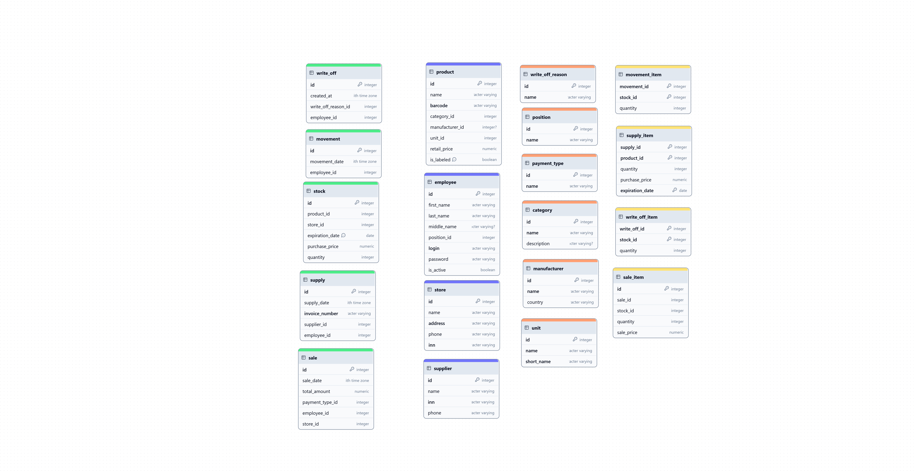
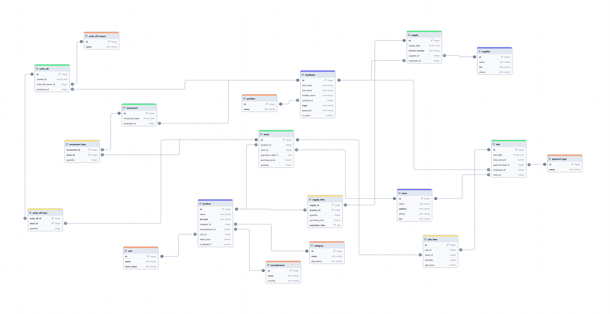

# ПРАКТИЧЕСКАЯ РАБОТА № 6. ФИЗИЧЕСКОЕ ПРОЕКТИРОВАНИЕ БАЗЫ ДАННЫХ

## Перенос структуры базы данных в chartdb

Рисунок 1 – Создание таблиц

Рисунок 2 – полная диаграмма

## Выгрузка сгенерированного sql-кода

Листинг 1 — Исходный SQL-код, сгенерированный ChartDB

CREATE TABLE category (

id integer NOT NULL PRIMARY KEY,

name varchar(500) NOT NULL UNIQUE,

description varchar(500)

);

CREATE TABLE unit (

id integer NOT NULL PRIMARY KEY,

name varchar(500) NOT NULL UNIQUE,

short_name varchar(500) NOT NULL UNIQUE

);

CREATE TABLE position (

id integer NOT NULL PRIMARY KEY,

name varchar(500) NOT NULL UNIQUE

);

CREATE TABLE payment_type (

id integer NOT NULL PRIMARY KEY,

name varchar(500) NOT NULL UNIQUE

);

CREATE TABLE write_off_reason (

id integer NOT NULL PRIMARY KEY,

name varchar(500) NOT NULL UNIQUE

);

CREATE TABLE manufacturer (

id integer NOT NULL PRIMARY KEY,

name varchar(500) NOT NULL UNIQUE,

country varchar(500) NOT NULL

);

CREATE TABLE supplier (

id integer NOT NULL PRIMARY KEY,

name varchar(500) NOT NULL,

inn varchar(500) NOT NULL UNIQUE,

phone varchar(500) NOT NULL

);

CREATE TABLE store (

id integer NOT NULL PRIMARY KEY,

name varchar(500) NOT NULL,

address varchar(500) NOT NULL UNIQUE,

phone varchar(500),

inn varchar(500)

);

CREATE TABLE employee (

id integer NOT NULL PRIMARY KEY,

first_name varchar(500) NOT NULL,

last_name varchar(500) NOT NULL,

middle_name varchar(500),

login varchar(500) NOT NULL UNIQUE,

password varchar(500) NOT NULL,

is_active boolean NOT NULL,

position_id integer NOT NULL

);

CREATE TABLE product (

id integer NOT NULL PRIMARY KEY,

name varchar(500) NOT NULL,

barcode varchar(500) NOT NULL UNIQUE,

retail_price numeric NOT NULL,

is_labeled boolean NOT NULL,

category_id integer NOT NULL,

manufacturer_id integer,

unit_id integer NOT NULL

);

CREATE TABLE supply (

id integer NOT NULL PRIMARY KEY,

supply_date timestamptz NOT NULL,

invoice_number varchar(500) NOT NULL UNIQUE,

supplier_id integer NOT NULL,

employee_id integer NOT NULL

);

CREATE TABLE stock (

id integer NOT NULL PRIMARY KEY,

quantity integer NOT NULL,

purchase_price numeric NOT NULL,

expiration_date date NOT NULL,

product_id integer NOT NULL,

store_id integer NOT NULL,

supply_id integer NOT NULL

);

CREATE TABLE sale (

id integer NOT NULL PRIMARY KEY,

sale_date timestamptz NOT NULL,

total_amount numeric NOT NULL,

employee_id integer NOT NULL,

store_id integer NOT NULL,

payment_type_id integer NOT NULL

);

CREATE TABLE movement (

id integer NOT NULL PRIMARY KEY,

movement_date timestamptz NOT NULL,

employee_id integer NOT NULL

);

CREATE TABLE write_off (

id integer NOT NULL PRIMARY KEY,

created_at timestamptz NOT NULL,

employee_id integer NOT NULL,

write_off_reason_id integer NOT NULL

);

CREATE TABLE supply_item (

supply_id integer NOT NULL PRIMARY KEY,

product_id integer NOT NULL PRIMARY KEY,

quantity integer NOT NULL,

purchase_price numeric NOT NULL,

expiration_date date NOT NULL

);

CREATE TABLE sale_item (

sale_id integer NOT NULL PRIMARY KEY,

stock_id integer NOT NULL PRIMARY KEY,

quantity integer NOT NULL,

sale_price numeric NOT NULL

);

CREATE TABLE movement_item (

movement_id integer NOT NULL PRIMARY KEY,

stock_id integer NOT NULL PRIMARY KEY,

quantity integer NOT NULL

);

CREATE TABLE write_off_item (

write_off_id integer NOT NULL PRIMARY KEY,

stock_id integer NOT NULL PRIMARY KEY,

quantity integer NOT NULL

);

ALTER TABLE employee ADD CONSTRAINT employee_position_id_fk FOREIGN KEY (position_id) REFERENCES position (id);

ALTER TABLE product ADD CONSTRAINT product_category_id_fk FOREIGN KEY (category_id) REFERENCES category (id);

ALTER TABLE product ADD CONSTRAINT product_manufacturer_id_fk FOREIGN KEY (manufacturer_id) REFERENCES manufacturer (id);

ALTER TABLE product ADD CONSTRAINT product_unit_id_fk FOREIGN KEY (unit_id) REFERENCES unit (id);

ALTER TABLE supply ADD CONSTRAINT supply_supplier_id_fk FOREIGN KEY (supplier_id) REFERENCES supplier (id);

ALTER TABLE supply ADD CONSTRAINT supply_employee_id_fk FOREIGN KEY (employee_id) REFERENCES employee (id);

ALTER TABLE stock ADD CONSTRAINT stock_product_id_fk FOREIGN KEY (product_id) REFERENCES product (id);

ALTER TABLE stock ADD CONSTRAINT stock_store_id_fk FOREIGN KEY (store_id) REFERENCES store (id);

ALTER TABLE stock ADD CONSTRAINT stock_supply_id_fk FOREIGN KEY (supply_id) REFERENCES supply (id);

ALTER TABLE sale ADD CONSTRAINT sale_employee_id_fk FOREIGN KEY (employee_id) REFERENCES employee (id);

ALTER TABLE sale ADD CONSTRAINT sale_store_id_fk FOREIGN KEY (store_id) REFERENCES store (id);

ALTER TABLE sale ADD CONSTRAINT sale_payment_type_id_fk FOREIGN KEY (payment_type_id) REFERENCES payment_type (id);

ALTER TABLE movement ADD CONSTRAINT movement_employee_id_fk FOREIGN KEY (employee_id) REFERENCES employee (id);

ALTER TABLE write_off ADD CONSTRAINT write_off_employee_id_fk FOREIGN KEY (employee_id) REFERENCES employee (id);

ALTER TABLE write_off ADD CONSTRAINT write_off_reason_id_fk FOREIGN KEY (write_off_reason_id) REFERENCES write_off_reason (id);

ALTER TABLE supply_item ADD CONSTRAINT supply_item_supply_id_fk FOREIGN KEY (supply_id) REFERENCES supply (id);

ALTER TABLE supply_item ADD CONSTRAINT supply_item_product_id_fk FOREIGN KEY (product_id) REFERENCES product (id);

ALTER TABLE sale_item ADD CONSTRAINT sale_item_sale_id_fk FOREIGN KEY (sale_id) REFERENCES sale (id);

ALTER TABLE sale_item ADD CONSTRAINT sale_item_stock_id_fk FOREIGN KEY (stock_id) REFERENCES stock (id);

ALTER TABLE movement_item ADD CONSTRAINT movement_item_movement_id_fk FOREIGN KEY (movement_id) REFERENCES movement (id);

ALTER TABLE movement_item ADD CONSTRAINT movement_item_stock_id_fk FOREIGN KEY (stock_id) REFERENCES stock (id);

ALTER TABLE write_off_item ADD CONSTRAINT write_off_item_write_off_id_fk FOREIGN KEY (write_off_id) REFERENCES write_off (id);

ALTER TABLE write_off_item ADD CONSTRAINT write_off_item_stock_id_fk FOREIGN KEY (stock_id) REFERENCES stock (id);

## Ручная доработка сгенерированного sql-кода

### Оптимизация размерности и типов данных

При экспорте генератор кода ChartDB подставил значения по умолчанию: всем строковым полям назначил varchar(500), а числовым — тип numeric без указания точности. Оставлять их в таком виде недопустимо: избыточный лимит varchar(500) разрушает контроль целостности данных, а numeric без скобок заставляет PostgreSQL выделять память динамически, что замедляет математические агрегации.

Все вхождения varchar(500) заменены на адекватные значения согласно бизнес-логике: код страны — varchar(100), названия — varchar(100)/varchar(255), адрес — varchar(255). Все вхождения numeric без скобок заменены: для денежных сумм — numeric(10, 2).

### Модернизация суррогатных ключей под современный стандарт

Исторически для суррогатных ключей использовался псевдотип SERIAL. SERIAL — это не тип данных, а синтаксический сахар: СУБД создаёт столбец integer и отдельный объект SEQUENCE. Это порождает уязвимость рассинхронизации: при ручной вставке конкретного ID счётчик последовательности не обновляется, что в дальнейшем приводит к падению с ошибкой UNIQUE VIOLATION.

Современный стандарт ISO SQL:2003 предписывает использовать IDENTITY, который жёстко связывает последовательность со столбцом. Все первичные ключи вида id serial заменены на id int GENERATED BY DEFAULT AS IDENTITY PRIMARY KEY. Для промежуточных таблиц (supply_item, sale_item, movement_item, write_off_item) IDENTITY не применяется — у них составной первичный ключ.

### Установка значений по умолчанию

Конструкция DEFAULT позволяет СУБД автоматически подставлять заранее заданное значение, если при вставке строки клиентское приложение пропустило поле. Это защищает таблицу от пустот (NULL) и упрощает код бэкенда.

Согласно матрице ограничений добавлены: DEFAULT CURRENT_TIMESTAMP для дат создания документов (supply_date, sale_date, movement_date, created_at), DEFAULT true для флага активности сотрудника is_active, DEFAULT 0 для числовых метрик количества.

### Доработка внешних связей — указание действий при UPDATE / DELETE

Внешние ключи обеспечивают ссылочную целостность, но СУБД нуждается в строгих инструкциях о том, что делать с дочерними строками при удалении или обновлении родительской записи. По умолчанию применяется NO ACTION.

Для связей со справочниками и ключевыми объектами дописано ON DELETE RESTRICT — нельзя удалить справочную запись, на которую ссылаются данные, что защищает исторические сведения. Для связей от позиций документов к их шапкам дописано ON DELETE CASCADE — позиция не может существовать без документа. Для промежуточных таблиц sale_item и write_off_item дополнительно указано ON UPDATE CASCADE.

### Добавление комментариев

DDL-команды COMMENT ON TABLE и COMMENT ON COLUMN позволяют закрепить текстовое описание бизнес-логики прямо в системных каталогах СУБД. Любой разработчик, подключившись к базе через DBeaver или pgAdmin, сразу увидит назначение таблицы без обращения к внешней документации.

В скрипт добавлены поясняющие комментарии к наиболее сложным и неочевидным таблицам: stock (товарный регистр), supply_item и write_off_item (слабые сущности — позиции документов).

### Изменение порядка создания таблиц и связей

Интерпретатор PostgreSQL исполняет DDL-скрипт строго последовательно, сверху вниз. Если таблица ссылается на ещё не созданную таблицу, скрипт упадёт с фатальной ошибкой «relation does not exist». Процесс выстраивания правильной очерёдности, при которой родитель создаётся раньше ребёнка, называется топологической сортировкой.

Команды CREATE TABLE выстроены по строгой иерархии: Уровень 1 — независимые справочники (category, unit, position, payment_type, write_off_reason, manufacturer); Уровень 2 — зависимые справочники отсутствуют; Уровень 3 — ключевые объекты (supplier, store, employee, product); Уровень 4 — документы (supply, stock, sale, movement, write_off); Уровень 5 — промежуточные таблицы (supply_item, sale_item, movement_item, write_off_item). Блок ALTER TABLE с внешними ключами вынесен в самый конец скрипта — на момент его выполнения все таблицы уже созданы, поэтому порядок самих ALTER TABLE значения не имеет.

Листинг 2 — Итоговый SQL-скрипт после ручной доработки

--

-- УРОВЕНЬ 1. НЕЗАВИСИМЫЕ СПРАВОЧНИКИ

--

CREATE TABLE category (

id int GENERATED BY DEFAULT AS IDENTITY PRIMARY KEY,

name varchar(100) NOT NULL UNIQUE,

description text

);

COMMENT ON TABLE category IS 'Справочник категорий товаров';

CREATE TABLE unit (

id int GENERATED BY DEFAULT AS IDENTITY PRIMARY KEY,

name varchar(50) NOT NULL UNIQUE,

short_name varchar(5) NOT NULL UNIQUE

);

CREATE TABLE position (

id int GENERATED BY DEFAULT AS IDENTITY PRIMARY KEY,

name varchar(100) NOT NULL UNIQUE

);

CREATE TABLE payment_type (

id int GENERATED BY DEFAULT AS IDENTITY PRIMARY KEY,

name varchar(50) NOT NULL UNIQUE

);

CREATE TABLE write_off_reason (

id int GENERATED BY DEFAULT AS IDENTITY PRIMARY KEY,

name varchar(100) NOT NULL UNIQUE

);

CREATE TABLE manufacturer (

id int GENERATED BY DEFAULT AS IDENTITY PRIMARY KEY,

name varchar(255) NOT NULL UNIQUE,

country varchar(100) NOT NULL

);

--

-- УРОВЕНЬ 3. КЛЮЧЕВЫЕ ОБЪЕКТЫ

--

CREATE TABLE supplier (

id int GENERATED BY DEFAULT AS IDENTITY PRIMARY KEY,

name varchar(255) NOT NULL,

inn varchar(12) NOT NULL UNIQUE,

phone varchar(20) NOT NULL

);

CREATE TABLE store (

id int GENERATED BY DEFAULT AS IDENTITY PRIMARY KEY,

name varchar(255) NOT NULL,

address varchar(255) NOT NULL UNIQUE,

phone varchar(20),

inn varchar(12)

);

CREATE TABLE employee (

id int GENERATED BY DEFAULT AS IDENTITY PRIMARY KEY,

first_name varchar(100) NOT NULL,

last_name varchar(100) NOT NULL,

middle_name varchar(100),

login varchar(50) NOT NULL UNIQUE,

password varchar(255) NOT NULL,

is_active boolean NOT NULL DEFAULT true,

position_id integer NOT NULL

);

CREATE TABLE product (

id int GENERATED BY DEFAULT AS IDENTITY PRIMARY KEY,

name varchar(255) NOT NULL,

barcode varchar(13) NOT NULL UNIQUE,

retail_price numeric(10, 2) NOT NULL,

is_labeled boolean NOT NULL DEFAULT false,

category_id integer NOT NULL,

manufacturer_id integer,

unit_id integer NOT NULL

);

--

-- УРОВЕНЬ 4. ДОКУМЕНТЫ И РЕГИСТРЫ

--

CREATE TABLE supply (

id int GENERATED BY DEFAULT AS IDENTITY PRIMARY KEY,

supply_date timestamptz NOT NULL DEFAULT CURRENT_TIMESTAMP,

invoice_number varchar(50) NOT NULL UNIQUE,

supplier_id integer NOT NULL,

employee_id integer NOT NULL

);

CREATE TABLE stock (

id int GENERATED BY DEFAULT AS IDENTITY PRIMARY KEY,

quantity integer NOT NULL DEFAULT 0,

purchase_price numeric(10, 2) NOT NULL,

expiration_date date NOT NULL,

product_id integer NOT NULL,

store_id integer NOT NULL,

supply_id integer NOT NULL

);

COMMENT ON TABLE stock IS

'Регистр: товарные партии на балансе магазина';

CREATE TABLE sale (

id int GENERATED BY DEFAULT AS IDENTITY PRIMARY KEY,

sale_date timestamptz NOT NULL DEFAULT CURRENT_TIMESTAMP,

total_amount numeric(10, 2) NOT NULL DEFAULT 0.00,

employee_id integer NOT NULL,

store_id integer NOT NULL,

payment_type_id integer NOT NULL

);

COMMENT ON TABLE sale IS 'Шапка документа кассового чека';

CREATE TABLE movement (

id int GENERATED BY DEFAULT AS IDENTITY PRIMARY KEY,

movement_date timestamptz NOT NULL DEFAULT CURRENT_TIMESTAMP,

employee_id integer NOT NULL

);

CREATE TABLE write_off (

id int GENERATED BY DEFAULT AS IDENTITY PRIMARY KEY,

created_at timestamptz NOT NULL DEFAULT CURRENT_TIMESTAMP,

employee_id integer NOT NULL,

write_off_reason_id integer NOT NULL

);

--

-- УРОВЕНЬ 5. ПРОМЕЖУТОЧНЫЕ ТАБЛИЦЫ

--

CREATE TABLE supply_item (

supply_id integer NOT NULL,

product_id integer NOT NULL,

quantity integer NOT NULL DEFAULT 1,

purchase_price numeric(10, 2) NOT NULL,

expiration_date date NOT NULL,

PRIMARY KEY (supply_id, product_id)

);

COMMENT ON TABLE supply_item IS

'Слабая сущность: строки приходной накладной';

CREATE TABLE sale_item (

sale_id integer NOT NULL,

stock_id integer NOT NULL,

quantity integer NOT NULL DEFAULT 1,

sale_price numeric(10, 2) NOT NULL,

PRIMARY KEY (sale_id, stock_id)

);

CREATE TABLE movement_item (

movement_id integer NOT NULL,

stock_id integer NOT NULL,

quantity integer NOT NULL DEFAULT 1,

PRIMARY KEY (movement_id, stock_id)

);

CREATE TABLE write_off_item (

write_off_id integer NOT NULL,

stock_id integer NOT NULL,

quantity integer NOT NULL DEFAULT 1,

PRIMARY KEY (write_off_id, stock_id)

);

COMMENT ON TABLE write_off_item IS

'Слабая сущность: строки акта списания';

--

-- БЛОК ОГРАНИЧЕНИЙ ВНЕШНИХ КЛЮЧЕЙ

--

-- Защита справочников (ON DELETE RESTRICT)

ALTER TABLE employee ADD CONSTRAINT employee_position_id_fk

FOREIGN KEY (position_id) REFERENCES position (id)

ON DELETE RESTRICT;

ALTER TABLE product ADD CONSTRAINT product_category_id_fk

FOREIGN KEY (category_id) REFERENCES category (id)

ON DELETE RESTRICT;

ALTER TABLE product ADD CONSTRAINT product_manufacturer_id_fk

FOREIGN KEY (manufacturer_id) REFERENCES manufacturer (id)

ON DELETE RESTRICT;

ALTER TABLE product ADD CONSTRAINT product_unit_id_fk

FOREIGN KEY (unit_id) REFERENCES unit (id)

ON DELETE RESTRICT;

ALTER TABLE sale ADD CONSTRAINT sale_payment_type_id_fk

FOREIGN KEY (payment_type_id) REFERENCES payment_type (id)

ON DELETE RESTRICT;

ALTER TABLE write_off ADD CONSTRAINT write_off_reason_id_fk

FOREIGN KEY (write_off_reason_id)

REFERENCES write_off_reason (id) ON DELETE RESTRICT;

-- Историческая безопасность документов (ON DELETE RESTRICT)

ALTER TABLE supply ADD CONSTRAINT supply_supplier_id_fk

FOREIGN KEY (supplier_id) REFERENCES supplier (id)

ON DELETE RESTRICT;

ALTER TABLE supply ADD CONSTRAINT supply_employee_id_fk

FOREIGN KEY (employee_id) REFERENCES employee (id)

ON DELETE RESTRICT;

ALTER TABLE stock ADD CONSTRAINT stock_product_id_fk

FOREIGN KEY (product_id) REFERENCES product (id)

ON DELETE RESTRICT;

ALTER TABLE stock ADD CONSTRAINT stock_store_id_fk

FOREIGN KEY (store_id) REFERENCES store (id)

ON DELETE RESTRICT;

ALTER TABLE stock ADD CONSTRAINT stock_supply_id_fk

FOREIGN KEY (supply_id) REFERENCES supply (id)

ON DELETE RESTRICT;

ALTER TABLE sale ADD CONSTRAINT sale_employee_id_fk

FOREIGN KEY (employee_id) REFERENCES employee (id)

ON DELETE RESTRICT;

ALTER TABLE sale ADD CONSTRAINT sale_store_id_fk

FOREIGN KEY (store_id) REFERENCES store (id)

ON DELETE RESTRICT;

ALTER TABLE movement ADD CONSTRAINT movement_employee_id_fk

FOREIGN KEY (employee_id) REFERENCES employee (id)

ON DELETE RESTRICT;

ALTER TABLE write_off ADD CONSTRAINT write_off_employee_id_fk

FOREIGN KEY (employee_id) REFERENCES employee (id)

ON DELETE RESTRICT;

-- Целостность документов: позиции зависят от шапок

-- (ON DELETE CASCADE)

ALTER TABLE supply_item ADD CONSTRAINT supply_item_supply_id_fk

FOREIGN KEY (supply_id) REFERENCES supply (id)

ON DELETE CASCADE ON UPDATE CASCADE;

ALTER TABLE supply_item ADD CONSTRAINT supply_item_product_id_fk

FOREIGN KEY (product_id) REFERENCES product (id)

ON DELETE RESTRICT;

ALTER TABLE sale_item ADD CONSTRAINT sale_item_sale_id_fk

FOREIGN KEY (sale_id) REFERENCES sale (id)

ON DELETE CASCADE ON UPDATE CASCADE;

ALTER TABLE sale_item ADD CONSTRAINT sale_item_stock_id_fk

FOREIGN KEY (stock_id) REFERENCES stock (id)

ON DELETE RESTRICT;

ALTER TABLE movement_item

ADD CONSTRAINT movement_item_movement_id_fk

FOREIGN KEY (movement_id) REFERENCES movement (id)

ON DELETE CASCADE ON UPDATE CASCADE;

ALTER TABLE movement_item ADD CONSTRAINT movement_item_stock_id_fk

FOREIGN KEY (stock_id) REFERENCES stock (id)

ON DELETE RESTRICT;

ALTER TABLE write_off_item

ADD CONSTRAINT write_off_item_write_off_id_fk

FOREIGN KEY (write_off_id) REFERENCES write_off (id)

ON DELETE CASCADE ON UPDATE CASCADE;

ALTER TABLE write_off_item ADD CONSTRAINT write_off_item_stock_id_fk

FOREIGN KEY (stock_id) REFERENCES stock (id)

ON DELETE RESTRICT;
