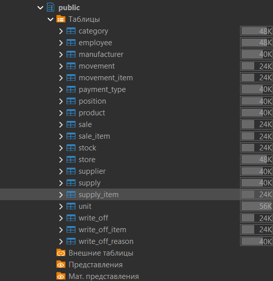
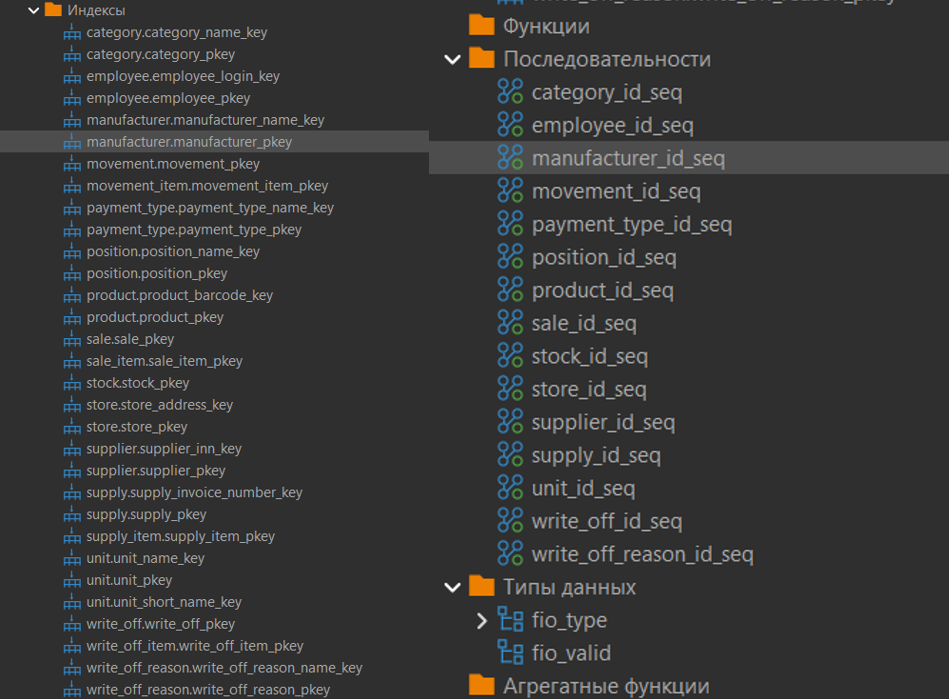
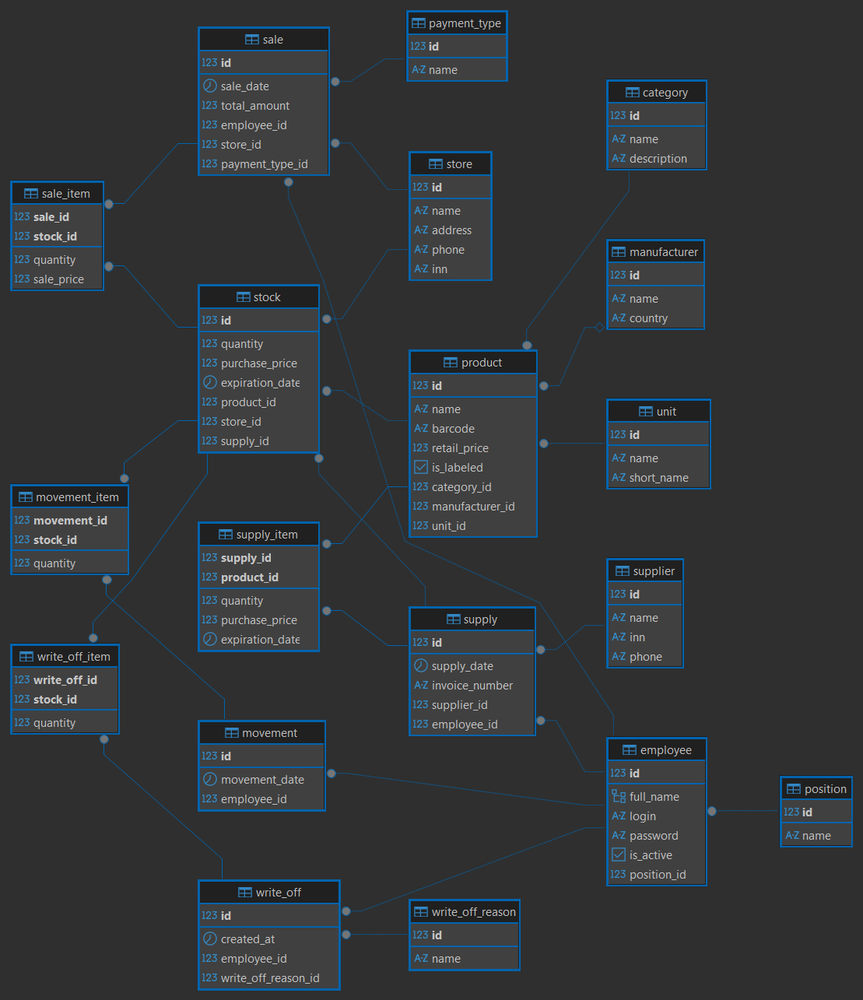
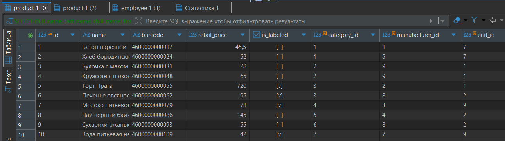
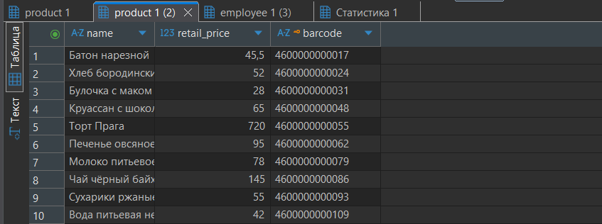
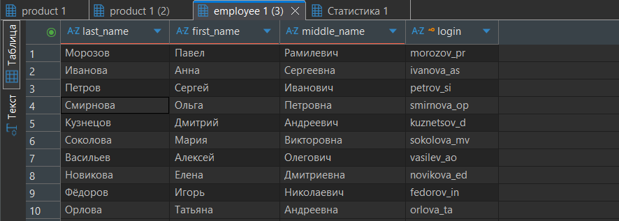

# ПРАКТИКА 7. СОЗДАНИЕ БАЗЫ ДАННЫХ В СУБД POSTGRESQL И РЕАЛИЗАЦИЯ ДЕКЛАРАТИВНЫХ ОГРАНИЧЕНИЙ ЦЕЛОСТНОСТИ

Таблица 1. Реализованные ограничения CHECK

| Таблица и атрибут       | Условие CHECK                    | Имя ограничения             |
|-------------------------|----------------------------------|-----------------------------|
| category.name           | длина названия больше 2 символов | chk_category_name           |
| unit.name               | только буквы                     | chk_unit_name               |
| unit.short_name         | длина от 1 до 5 символов         | chk_unit_short_name         |
| position.name           | длина больше 3 символов          | chk_position_name           |
| payment_type.name       | длина больше 3 символов          | chk_payment_type_name       |
| write_off_reason.name   | длина больше 3 символов          | chk_write_off_reason_name   |
| manufacturer.name       | длина больше 2 символов          | chk_manufacturer_name       |
| manufacturer.country    | только буквы                     | chk_manufacturer_country    |
| supplier.inn            | 10 или 12 цифр                   | chk_supplier_inn            |
| supplier.phone          | формат телефонного номера        | chk_supplier_phone          |
| store.address           | длина больше 10 символов         | chk_store_address           |
| employee.login          | не короче 5 символов             | chk_employee_login          |
| employee.password       | не короче 8 символов             | chk_employee_password       |
| product.name            | длина больше 3 символов          | chk_product_name            |
| product.barcode         | только цифры, 8 или 13 символов  | chk_product_barcode         |
| product.retail_price    | цена строго больше нуля          | chk_product_retail_price    |
| stock.quantity          | количество больше или равно нулю | chk_stock_quantity          |
| stock.purchase_price    | цена строго больше нуля          | chk_stock_purchase_price    |
| sale.total_amount       | сумма больше или равна нулю      | chk_sale_total_amount       |
| supply_item.quantity    | количество строго больше нуля    | chk_supply_item_quantity    |
| sale_item.sale_price    | цена строго больше нуля          | chk_sale_item_price         |
| movement_item.quantity  | количество строго больше нуля    | chk_movement_item_quantity  |
| write_off_item.quantity | количество строго больше нуля    | chk_write_off_item_quantity |

Листинг 1 — Доработанный SQL-код

-- Очистка схемы перед повторным запуском

DROP TABLE IF EXISTS write_off_item CASCADE;

DROP TABLE IF EXISTS movement_item CASCADE;

DROP TABLE IF EXISTS sale_item CASCADE;

DROP TABLE IF EXISTS supply_item CASCADE;

DROP TABLE IF EXISTS write_off CASCADE;

DROP TABLE IF EXISTS movement CASCADE;

DROP TABLE IF EXISTS sale CASCADE;

DROP TABLE IF EXISTS stock CASCADE;

DROP TABLE IF EXISTS supply CASCADE;

DROP TABLE IF EXISTS product CASCADE;

DROP TABLE IF EXISTS employee CASCADE;

DROP TABLE IF EXISTS store CASCADE;

DROP TABLE IF EXISTS supplier CASCADE;

DROP TABLE IF EXISTS manufacturer CASCADE;

DROP TABLE IF EXISTS write_off_reason CASCADE;

DROP TABLE IF EXISTS payment_type CASCADE;

DROP TABLE IF EXISTS position CASCADE;

DROP TABLE IF EXISTS unit CASCADE;

DROP TABLE IF EXISTS category CASCADE;

DROP DOMAIN IF EXISTS fio_valid CASCADE;

DROP TYPE   IF EXISTS fio_type  CASCADE;

-- Составной тип и домен для ФИО сотрудника

CREATE TYPE fio_type AS (

    last_name varchar(100),

    first_name varchar(100),

    middle_name varchar(100)

);

CREATE DOMAIN fio_valid AS fio_type

CHECK (

    (VALUE).last_name IS NOT NULL AND length(trim((VALUE).last_name)) \> 1

    AND

    (VALUE).first_name IS NOT NULL AND length(trim((VALUE).first_name)) \> 1

);

-- Уровень 1. Независимые справочники

CREATE TABLE category (

    id int GENERATED BY DEFAULT AS IDENTITY PRIMARY KEY,

    name varchar(100) NOT NULL UNIQUE

        CONSTRAINT chk_category_name CHECK (length(trim(name)) \> 2),

    description text

);

CREATE TABLE unit (

    id int GENERATED BY DEFAULT AS IDENTITY PRIMARY KEY,

    name varchar(50) NOT NULL UNIQUE

        CONSTRAINT chk_unit_name CHECK (name ~ '^\[А-Яа-яЁёA-Za-z \]+\$'),

    short_name varchar(5) NOT NULL UNIQUE

        CONSTRAINT chk_unit_short_name CHECK (length(trim(short_name)) BETWEEN 1 AND 5)

);

CREATE TABLE position (

    id int GENERATED BY DEFAULT AS IDENTITY PRIMARY KEY,

    name varchar(100) NOT NULL UNIQUE

        CONSTRAINT chk_position_name CHECK (length(trim(name)) \> 3)

);

CREATE TABLE payment_type (

    id int GENERATED BY DEFAULT AS IDENTITY PRIMARY KEY,

    name varchar(50) NOT NULL UNIQUE

        CONSTRAINT chk_payment_type_name CHECK (length(trim(name)) \> 3)

);

CREATE TABLE write_off_reason (

    id int GENERATED BY DEFAULT AS IDENTITY PRIMARY KEY,

    name varchar(100) NOT NULL UNIQUE

        CONSTRAINT chk_write_off_reason_name CHECK (length(trim(name)) \> 3)

);

CREATE TABLE manufacturer (

    id int GENERATED BY DEFAULT AS IDENTITY PRIMARY KEY,

    name varchar(255) NOT NULL UNIQUE

        CONSTRAINT chk_manufacturer_name CHECK (length(trim(name)) \> 2),

    country varchar(100) NOT NULL DEFAULT 'Россия'

        CONSTRAINT chk_manufacturer_country CHECK (country ~ '^\[А-Яа-яЁёA-Za-z -\]+\$')

);

-- Уровень 3. Ключевые объекты

CREATE TABLE supplier (

    id int GENERATED BY DEFAULT AS IDENTITY PRIMARY KEY,

    name varchar(255) NOT NULL

        CONSTRAINT chk_supplier_name CHECK (length(trim(name)) \> 2),

    inn varchar(12) NOT NULL UNIQUE

        CONSTRAINT chk_supplier_inn CHECK (inn ~ '^\[0-9\]{10}(\[0-9\]{2})?\$'),

    phone varchar(20) NOT NULL

        CONSTRAINT chk_supplier_phone CHECK (phone ~ '^\\?\[0-9 ()-\]{6,20}\$')

);

CREATE TABLE store (

    id int GENERATED BY DEFAULT AS IDENTITY PRIMARY KEY,

    name varchar(255) NOT NULL,

    address varchar(255) NOT NULL UNIQUE

        CONSTRAINT chk_store_address CHECK (length(trim(address)) \> 10),

    phone varchar(20),

    inn varchar(12)

        CONSTRAINT chk_store_inn CHECK (inn IS NULL OR inn ~ '^\[0-9\]{10}(\[0-9\]{2})?\$')

);

CREATE TABLE employee (

    id int GENERATED BY DEFAULT AS IDENTITY PRIMARY KEY,

    full_name fio_valid NOT NULL,

    login varchar(50) NOT NULL UNIQUE

        CONSTRAINT chk_employee_login CHECK (length(trim(login)) \>= 5),

    password varchar(255) NOT NULL

        CONSTRAINT chk_employee_password CHECK (length(password) \>= 8),

    is_active boolean NOT NULL DEFAULT true,

    position_id integer NOT NULL

);

CREATE TABLE product (

    id int GENERATED BY DEFAULT AS IDENTITY PRIMARY KEY,

    name varchar(255) NOT NULL

        CONSTRAINT chk_product_name CHECK (length(trim(name)) \> 3),

    barcode varchar(13) NOT NULL UNIQUE

        CONSTRAINT chk_product_barcode CHECK (barcode ~ '^(\[0-9\]{8}\|\[0-9\]{13})\$'),

    retail_price numeric(10, 2) NOT NULL

        CONSTRAINT chk_product_retail_price CHECK (retail_price \> 0),

    is_labeled boolean NOT NULL DEFAULT false,

    category_id integer NOT NULL,

    manufacturer_id integer,

    unit_id integer NOT NULL

);

-- Уровень 4. Документы и регистры

CREATE TABLE supply (

    id int GENERATED BY DEFAULT AS IDENTITY PRIMARY KEY,

    supply_date timestamptz NOT NULL DEFAULT CURRENT_TIMESTAMP,

    invoice_number varchar(50) NOT NULL UNIQUE,

    supplier_id integer NOT NULL,

    employee_id integer NOT NULL

);

CREATE TABLE stock (

    id int GENERATED BY DEFAULT AS IDENTITY PRIMARY KEY,

    quantity integer NOT NULL DEFAULT 0

        CONSTRAINT chk_stock_quantity CHECK (quantity \>= 0),

    purchase_price numeric(10, 2) NOT NULL

        CONSTRAINT chk_stock_purchase_price CHECK (purchase_price \> 0),

    expiration_date date NOT NULL,

    product_id integer NOT NULL,

    store_id integer NOT NULL,

    supply_id integer NOT NULL

);

CREATE TABLE sale (

    id int GENERATED BY DEFAULT AS IDENTITY PRIMARY KEY,

    sale_date timestamptz NOT NULL DEFAULT CURRENT_TIMESTAMP,

    total_amount numeric(10, 2) NOT NULL DEFAULT 0.00

        CONSTRAINT chk_sale_total_amount CHECK (total_amount \>= 0),

    employee_id integer NOT NULL,

    store_id integer NOT NULL,

    payment_type_id integer NOT NULL

);

CREATE TABLE movement (

    id int GENERATED BY DEFAULT AS IDENTITY PRIMARY KEY,

    movement_date timestamptz NOT NULL DEFAULT CURRENT_TIMESTAMP,

    employee_id integer NOT NULL

);

CREATE TABLE write_off (

    id int GENERATED BY DEFAULT AS IDENTITY PRIMARY KEY,

    created_at timestamptz NOT NULL DEFAULT CURRENT_TIMESTAMP,

    employee_id integer NOT NULL,

    write_off_reason_id integer NOT NULL

);

-- Уровень 5. Промежуточные таблицы

CREATE TABLE supply_item (

    supply_id integer NOT NULL,

    product_id integer NOT NULL,

    quantity integer NOT NULL DEFAULT 1

        CONSTRAINT chk_supply_item_quantity CHECK (quantity \> 0),

    purchase_price numeric(10, 2) NOT NULL

        CONSTRAINT chk_supply_item_price CHECK (purchase_price \> 0),

    expiration_date date NOT NULL,

    PRIMARY KEY (supply_id, product_id)

);

CREATE TABLE sale_item (

    sale_id integer NOT NULL,

    stock_id integer NOT NULL,

    quantity integer NOT NULL DEFAULT 1

        CONSTRAINT chk_sale_item_quantity CHECK (quantity \> 0),

    sale_price numeric(10, 2) NOT NULL

        CONSTRAINT chk_sale_item_price CHECK (sale_price \> 0),

    PRIMARY KEY (sale_id, stock_id)

);

CREATE TABLE movement_item (

    movement_id integer NOT NULL,

    stock_id integer NOT NULL,

    quantity integer NOT NULL DEFAULT 1

        CONSTRAINT chk_movement_item_quantity CHECK (quantity \> 0),

    PRIMARY KEY (movement_id, stock_id)

);

CREATE TABLE write_off_item (

    write_off_id integer NOT NULL,

    stock_id integer NOT NULL,

    quantity integer NOT NULL DEFAULT 1

        CONSTRAINT chk_write_off_item_quantity CHECK (quantity \> 0),

    PRIMARY KEY (write_off_id, stock_id)

);

-- Внешние ключи

ALTER TABLE employee ADD CONSTRAINT employee_position_id_fk

    FOREIGN KEY (position_id) REFERENCES position (id) ON DELETE RESTRICT;

ALTER TABLE product ADD CONSTRAINT product_category_id_fk

    FOREIGN KEY (category_id) REFERENCES category (id) ON DELETE RESTRICT;

ALTER TABLE product ADD CONSTRAINT product_manufacturer_id_fk

    FOREIGN KEY (manufacturer_id) REFERENCES manufacturer (id) ON DELETE RESTRICT;

ALTER TABLE product ADD CONSTRAINT product_unit_id_fk

    FOREIGN KEY (unit_id) REFERENCES unit (id) ON DELETE RESTRICT;

ALTER TABLE sale ADD CONSTRAINT sale_payment_type_id_fk

    FOREIGN KEY (payment_type_id) REFERENCES payment_type (id) ON DELETE RESTRICT;

ALTER TABLE write_off ADD CONSTRAINT write_off_reason_id_fk

    FOREIGN KEY (write_off_reason_id) REFERENCES write_off_reason (id) ON DELETE RESTRICT;

ALTER TABLE supply ADD CONSTRAINT supply_supplier_id_fk

    FOREIGN KEY (supplier_id) REFERENCES supplier (id) ON DELETE RESTRICT;

ALTER TABLE supply ADD CONSTRAINT supply_employee_id_fk

    FOREIGN KEY (employee_id) REFERENCES employee (id) ON DELETE RESTRICT;

ALTER TABLE stock ADD CONSTRAINT stock_product_id_fk

    FOREIGN KEY (product_id) REFERENCES product (id) ON DELETE RESTRICT;

ALTER TABLE stock ADD CONSTRAINT stock_store_id_fk

    FOREIGN KEY (store_id) REFERENCES store (id) ON DELETE RESTRICT;

ALTER TABLE stock ADD CONSTRAINT stock_supply_id_fk

    FOREIGN KEY (supply_id) REFERENCES supply (id) ON DELETE RESTRICT;

ALTER TABLE sale ADD CONSTRAINT sale_employee_id_fk

    FOREIGN KEY (employee_id) REFERENCES employee (id) ON DELETE RESTRICT;

ALTER TABLE sale ADD CONSTRAINT sale_store_id_fk

    FOREIGN KEY (store_id) REFERENCES store (id) ON DELETE RESTRICT;

ALTER TABLE movement ADD CONSTRAINT movement_employee_id_fk

    FOREIGN KEY (employee_id) REFERENCES employee (id) ON DELETE RESTRICT;

ALTER TABLE write_off ADD CONSTRAINT write_off_employee_id_fk

    FOREIGN KEY (employee_id) REFERENCES employee (id) ON DELETE RESTRICT;

ALTER TABLE supply_item ADD CONSTRAINT supply_item_supply_id_fk

    FOREIGN KEY (supply_id) REFERENCES supply (id) ON DELETE CASCADE ON UPDATE CASCADE;

ALTER TABLE supply_item ADD CONSTRAINT supply_item_product_id_fk

    FOREIGN KEY (product_id) REFERENCES product (id) ON DELETE RESTRICT;

ALTER TABLE sale_item ADD CONSTRAINT sale_item_sale_id_fk

    FOREIGN KEY (sale_id) REFERENCES sale (id) ON DELETE CASCADE ON UPDATE CASCADE;

ALTER TABLE sale_item ADD CONSTRAINT sale_item_stock_id_fk

    FOREIGN KEY (stock_id) REFERENCES stock (id) ON DELETE RESTRICT;

ALTER TABLE movement_item ADD CONSTRAINT movement_item_movement_id_fk

    FOREIGN KEY (movement_id) REFERENCES movement (id) ON DELETE CASCADE ON UPDATE CASCADE;

ALTER TABLE movement_item ADD CONSTRAINT movement_item_stock_id_fk

    FOREIGN KEY (stock_id) REFERENCES stock (id) ON DELETE RESTRICT;

ALTER TABLE write_off_item ADD CONSTRAINT write_off_item_write_off_id_fk

    FOREIGN KEY (write_off_id) REFERENCES write_off (id) ON DELETE CASCADE ON UPDATE CASCADE;

ALTER TABLE write_off_item ADD CONSTRAINT write_off_item_stock_id_fk

    FOREIGN KEY (stock_id) REFERENCES stock (id) ON DELETE RESTRICT;

-- Наполнение данными

INSERT INTO category (name, description) VALUES

('Хлеб', 'Хлебобулочные изделия повседневного спроса'),

('Сдобная выпечка', 'Булочки, плюшки, круассаны'),

('Кондитерские изделия', 'Торты, пирожные, печенье'),

('Молочная продукция','Молоко, кефир, сметана, творог'),

('Чай и кофе', 'Горячие напитки в упаковке'),

('Снеки', 'Сухарики, чипсы, орехи'),

('Напитки', 'Вода, соки, газированные напитки'),

('Замороженные полуфабрикаты', 'Тесто, полуфабрикаты выпечки'),

('Бакалея', 'Крупы, сахар, мука'),

('Сезонные товары', 'Куличи, пряники, тематическая выпечка');

INSERT INTO unit (name, short_name) VALUES

('Штука', 'шт'), ('Упаковка', 'упак'), ('Килограмм', 'кг'),

('Грамм', 'г'), ('Литр', 'л'), ('Миллилитр', 'мл'),

('Батон', 'бат'), ('Коробка', 'кор'), ('Бутылка', 'бут'), ('Пакет', 'пак');

INSERT INTO position (name) VALUES

('Управляющий магазином'), ('Продавец-кассир'), ('Старший продавец'),

('Администратор системы'), ('Пекарь'), ('Кладовщик'), ('Товаровед'),

('Уборщик помещений'), ('Бухгалтер'), ('Стажёр продавца');

INSERT INTO payment_type (name) VALUES

('Наличный расчёт'), ('Банковская карта'), ('Система быстрых платежей'),

('Подарочный сертификат'), ('Бонусные баллы'), ('Безналичный перевод'),

('Оплата по QR-коду'), ('Электронный кошелёк'), ('Смешанная оплата'),

('Корпоративный счёт');

INSERT INTO write_off_reason (name) VALUES

('Истёк срок годности'), ('Механическое повреждение товара'),

('Брак производителя'), ('Нарушение условий хранения'),

('Бой стеклянной тары'), ('Потеря товарного вида'),

('Порча грызунами'), ('Недостача при инвентаризации'),

('Возврат от покупателя'), ('Списание на дегустацию');

INSERT INTO manufacturer (name, country) VALUES

('Хлебозавод №1', 'Россия'), ('Кондитерская фабрика Восход', 'Россия'),

('Молочный комбинат Луговое', 'Россия'), ('Компания Чайные традиции', 'Россия'),

('Завод Свежий хлеб', 'Россия'), ('Барилла', 'Италия'),

('Нестле', 'Швейцария'), ('Объединённые кондитеры', 'Россия'),

('Пекарня Каравай', 'Беларусь'), ('Фабрика Сладкий мир', 'Россия');

INSERT INTO supplier (name, inn, phone) VALUES

('ООО Хлебная лавка', '7701234567', '+74951112233'),

('АО Оптовая база Восток', '7802345678', '+78124445566'),

('ООО Молочный путь', '5003456789', '+74957778899'),

('ИП Кофейников А.В.', '772345678901', '+74953334455'),

('ООО Сладкий поставщик', '7704567890', '+74956667788'),

('АО Продторг', '7705678901', '+74959990011'),

('ООО Бакалея-сервис', '7706789012', '+74951231231'),

('ИП Снековый М.С.', '503456789012', '+74954564564'),

('ООО Хлебушек', '7708901234', '+74957897897'),

('АО Заморозка-Логистик', '7709012345', '+74950120120');

INSERT INTO store (name, address, phone, inn) VALUES

('Пекарня-магазин Центральная', 'г. Москва, ул. Тверская, д. 12, стр. 1', '+74951010101', '7710000001'),

('Пекарня-магазин Северная', 'г. Москва, ул. Дмитровская, д. 45', '+74951010102', '7710000002'),

('Пекарня-магазин Южная', 'г. Москва, ул. Чертановская, д. 8', '+74951010103', '7710000003'),

('Пекарня-магазин Восточная', 'г. Москва, ш. Энтузиастов, д. 31', '+74951010104', '7710000004'),

('Пекарня-магазин Западная', 'г. Москва, ул. Молодогвардейская, д. 5', '+74951010105', '7710000005'),

('Пекарня-магазин Парковая', 'г. Москва, ул. Парковая, д. 17', '+74951010106', '7710000006'),

('Пекарня-магазин Озёрная', 'г. Москва, ул. Озёрная, д. 22', '+74951010107', '7710000007'),

('Пекарня-магазин Лесная', 'г. Москва, ул. Лесная, д. 9, стр. 2', '+74951010108', '7710000008'),

('Пекарня-магазин Речная', 'г. Москва, наб. Речная, д. 14', '+74951010109', '7710000009'),

('Пекарня-магазин Садовая', 'г. Москва, ул. Садовая-Кудринская, д. 3', '+74951010110', '7710000010');

INSERT INTO employee (full_name, login, password, is_active, position_id) VALUES

(ROW('Морозов','Павел','Рамилевич')::fio_type, 'morozov_pr', 'passw0rd1', true, 1),

(ROW('Иванова','Анна','Сергеевна')::fio_type, 'ivanova_as', 'passw0rd2', true, 2),

(ROW('Петров','Сергей','Иванович')::fio_type, 'petrov_si', 'passw0rd3', true, 2),

(ROW('Смирнова','Ольга','Петровна')::fio_type, 'smirnova_op', 'passw0rd4', true, 3),

(ROW('Кузнецов','Дмитрий','Андреевич')::fio_type, 'kuznetsov_d', 'passw0rd5', true, 4),

(ROW('Соколова','Мария','Викторовна')::fio_type, 'sokolova_mv', 'passw0rd6', true, 5),

(ROW('Васильев','Алексей','Олегович')::fio_type, 'vasilev_ao', 'passw0rd7', true, 6),

(ROW('Новикова','Елена','Дмитриевна')::fio_type, 'novikova_ed', 'passw0rd8', true, 7),

(ROW('Фёдоров','Игорь','Николаевич')::fio_type, 'fedorov_in', 'passw0rd9', false, 2),

(ROW('Орлова','Татьяна','Андреевна')::fio_type, 'orlova_ta', 'passw0r10', true, 10);

INSERT INTO product (name, barcode, retail_price, is_labeled, category_id, manufacturer_id, unit_id) VALUES

('Батон нарезной', '4600000000017', 45.50, false, 1, 1, 7),

('Хлеб бородинский', '4600000000024', 52.00, false, 1, 5, 7),

('Булочка с маком', '4600000000031', 28.00, false, 2, 9, 1),

('Круассан с шоколадом', '4600000000048', 65.00, false, 2, 9, 1),

('Торт Прага', '4600000000055', 720.00, true, 3, 2, 1),

('Печенье овсяное', '4600000000062', 95.00, true, 3, 8, 2),

('Молоко питьевое 3,2%', '4600000000079', 78.00, true, 4, 3, 9),

('Чай чёрный байховый', '4600000000086', 145.00, false, 5, 4, 2),

('Сухарики ржаные', '4600000000093', 55.00, false, 6, 8, 2),

('Вода питьевая негаз.', '4600000000109', 42.00, true, 7, 7, 9);

INSERT INTO supply (supply_date, invoice_number, supplier_id, employee_id) VALUES

('2026-01-10 09:15:00+03', 'НАК-2026-0001', 1, 1),

('2026-01-11 10:30:00+03', 'НАК-2026-0002', 2, 1),

('2026-01-12 08:45:00+03', 'НАК-2026-0003', 3, 7),

('2026-01-13 11:00:00+03', 'НАК-2026-0004', 4, 1),

('2026-01-14 09:50:00+03', 'НАК-2026-0005', 5, 7),

('2026-01-15 10:10:00+03', 'НАК-2026-0006', 6, 1),

('2026-01-16 08:20:00+03', 'НАК-2026-0007', 7, 7),

('2026-01-17 12:00:00+03', 'НАК-2026-0008', 8, 1),

('2026-01-18 09:35:00+03', 'НАК-2026-0009', 9, 7),

('2026-01-19 10:45:00+03', 'НАК-2026-0010', 10, 1);

INSERT INTO stock (quantity, purchase_price, expiration_date, product_id, store_id, supply_id) VALUES

(120, 30.00, '2026-02-15', 1, 1, 1),

(80, 35.00, '2026-02-20', 2, 1, 1),

(150, 18.00, '2026-02-10', 3, 2, 2),

(90, 42.00, '2026-02-12', 4, 2, 2),

(25, 480.00, '2026-03-01', 5, 3, 3),

(60, 62.00, '2026-04-10', 6, 3, 3),

(100, 55.00, '2026-02-25', 7, 4, 4),

(70, 98.00, '2026-08-30', 8, 5, 5),

(110, 38.00, '2026-05-15', 9, 6, 6),

(200, 28.00, '2026-09-01', 10, 7, 7);

INSERT INTO sale (sale_date, total_amount, employee_id, store_id, payment_type_id) VALUES

('2026-01-20 12:05:00+03', 136.50, 2, 1, 1),

('2026-01-20 12:30:00+03', 104.00, 3, 1, 2),

('2026-01-20 13:10:00+03', 130.00, 2, 2, 2),

('2026-01-20 14:00:00+03', 720.00, 4, 3, 2),

('2026-01-20 15:25:00+03', 190.00, 3, 3, 1),

('2026-01-21 09:40:00+03', 156.00, 2, 4, 3),

('2026-01-21 10:15:00+03', 290.00, 4, 5, 2),

('2026-01-21 11:50:00+03', 110.00, 3, 6, 1),

('2026-01-21 13:30:00+03', 126.00, 2, 7, 7),

('2026-01-21 16:45:00+03', 227.50, 4, 1, 2);

INSERT INTO movement (movement_date, employee_id) VALUES

('2026-01-20 08:00:00+03', 6), ('2026-01-20 08:30:00+03', 6),

('2026-01-21 08:00:00+03', 7), ('2026-01-21 08:30:00+03', 6),

('2026-01-22 08:00:00+03', 7), ('2026-01-22 08:30:00+03', 6),

('2026-01-23 08:00:00+03', 7), ('2026-01-23 08:30:00+03', 6),

('2026-01-24 08:00:00+03', 7), ('2026-01-24 08:30:00+03', 6);

INSERT INTO write_off (created_at, employee_id, write_off_reason_id) VALUES

('2026-01-20 18:00:00+03', 1, 1), ('2026-01-20 18:10:00+03', 7, 2),

('2026-01-21 18:00:00+03', 1, 3), ('2026-01-21 18:15:00+03', 7, 6),

('2026-01-22 18:00:00+03', 1, 1), ('2026-01-22 18:20:00+03', 7, 4),

('2026-01-23 18:00:00+03', 1, 5), ('2026-01-23 18:30:00+03', 7, 8),

('2026-01-24 18:00:00+03', 1, 1), ('2026-01-24 18:40:00+03', 7, 9);

INSERT INTO supply_item (supply_id, product_id, quantity, purchase_price, expiration_date) VALUES

(1, 1, 120, 30.00, '2026-02-15'), (1, 2, 80, 35.00, '2026-02-20'),

(2, 3, 150, 18.00, '2026-02-10'), (2, 4, 90, 42.00, '2026-02-12'),

(3, 5, 25, 480.00, '2026-03-01'), (3, 6, 60, 62.00, '2026-04-10'),

(4, 7, 100, 55.00, '2026-02-25'), (5, 8, 70, 98.00, '2026-08-30'),

(6, 9, 110, 38.00, '2026-05-15'), (7, 10, 200, 28.00, '2026-09-01');

INSERT INTO sale_item (sale_id, stock_id, quantity, sale_price) VALUES

(1, 1, 2, 45.50), (1, 3, 1, 28.00), (2, 4, 1, 65.00), (2, 6, 1, 95.00),

(3, 3, 2, 28.00), (4, 5, 1, 720.00), (5, 6, 2, 95.00), (6, 7, 2, 78.00),

(7, 8, 2, 145.00), (8, 9, 2, 55.00);

INSERT INTO movement_item (movement_id, stock_id, quantity) VALUES

(1, 1, 30), (1, 2, 20), (2, 3, 40), (3, 4, 25), (4, 5, 10),

(5, 6, 15), (6, 7, 35), (7, 8, 20), (8, 9, 30), (9, 10, 50);

INSERT INTO write_off_item (write_off_id, stock_id, quantity) VALUES

(1, 1, 5), (2, 2, 3), (3, 3, 8), (4, 4, 2), (5, 5, 1),

(6, 6, 4), (7, 7, 6), (8, 8, 3), (9, 9, 7), (10, 10, 10);

-- Проверочные запросы

SELECT \* FROM product;

SELECT name, retail_price, barcode FROM product;

SELECT (full_name).last_name, (full_name).first_name, (full_name).middle_name, login FROM employee;

Рисунок 1 – Таблицы базы данных

Рисунок 2 – Индексы и Последовательности базы данных

Рисунок 3 – Er-диаграмма

**Результаты нескольких запросов:**

1\. SELECT \* FROM product;

Рисунок 4 – результат 1 запроса

2\. SELECT name, retail_price, barcode FROM product;

Рисунок 5 – результат 2 запроса

3\. SELECT (full_name).<u>last_name</u>, (full_name).<u>first_name</u>, (full_name).<u>middle_name</u>, login FROM employee;

Рисунок 6 – результат 3 запроса
